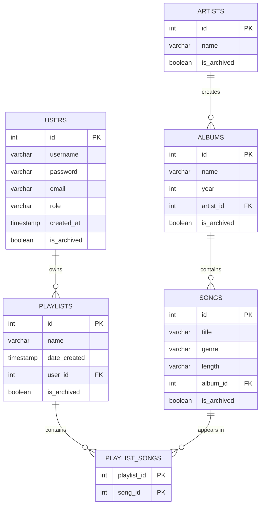

# 🎵 RecordingStudioConsoleApp

A Java console application for managing a recording studio's catalog of **artists, albums, songs, users, and playlists**. Built with **JDBC and MySQL** using a clean **3-tier architecture**, and built as my final project for the **Programming (Java) NC III** course.

---

## Table of Contents

- [Features](#features)
- [Tech Stack](#tech-stack)
- [Architecture](#architecture)
- [Project Structure](#project-structure)
- [Database Design](#database-design)
- [Use Cases](#use-cases)
- [Getting Started](#getting-started)
- [Running the App](#running-the-app)
- [Sample Usage](#sample-usage)
- [Design Decisions](#design-decisions)
- [Learning Path (3-Day Plan)](#learning-path-3-day-plan)
- [Troubleshooting](#troubleshooting)
- [Author](#author)

---

## Features

- **Full CRUD** for Artists, Albums, Songs, Users, and Playlists
- **Soft delete (archive / restore)** for Artists, Albums, Songs, Users, and Playlists, so data is never lost by accident. Archived records disappear from the active lists and can be brought back from the **Restore** menu, which shows the archived records first.
- **Permanent delete** (kept separate from archive) with a clear message when a record is still used by another record
- **Search** by keyword (Artists, Albums, Songs, Users, Playlists)
- **Login and registration** with BCrypt password hashing
- **One playlist per user** for regular users (enforced in the service layer)
- **Many-to-many playlists**: users add and remove songs in their own playlist (`playlist_songs` junction table)
- **Role-based access control**:
  - `USER`: browse the catalog, search songs, manage their own playlist, and add / remove songs in it
  - `ADMIN`: manage Songs, Artists, Albums, Users, and Playlists (create, update, search, archive, restore, delete)
- **Stable session flow**: logging out returns to the `Login / Register / Exit` menu. The app only closes when the user chooses **Exit**.
- **Input handling with no crashes**: letters, symbols, blank input, very large numbers, and non-existent IDs are rejected with a clear message and the menu keeps running
- **Clean console UI**:
  - Aligned tables with `+---+` borders and fixed column widths (`printf`)
  - Long names are shortened with `...` so the columns never break
  - `clearScreen()` between menus, plus a "Press Enter to continue..." pause so results stay readable
  - Confirmation or error message after every action
  - Readable database errors (for example, "This record is still used by other records...") instead of raw MySQL messages
- **SQL injection safe**: every query uses `PreparedStatement`

---

## Tech Stack

| Area | Technology |
|---|---|
| Language | Java 21 |
| Database | MySQL 8.x |
| Data access | JDBC (`PreparedStatement`, try-with-resources) |
| Build tool | Maven |
| Password hashing | jBCrypt (`org.mindrot:jbcrypt` 0.4) |
| JDBC driver | MySQL Connector/J (`com.mysql:mysql-connector-j` 9.7.0) |
| IDE (recommended) | IntelliJ IDEA |

---

## Architecture

The app follows a **3-tier architecture** with a strict one-way flow:

```
┌──────────────────────┐
│  Presentation Tier   │   Views: Scanner input, System.out output
└──────────┬───────────┘
           │ calls
┌──────────▼───────────┐
│     Service Tier     │   Business logic and validation (guard clauses, BCrypt)
└──────────┬───────────┘
           │ calls
┌──────────▼───────────┐
│  Data Access Tier    │   Repositories: JDBC and SQL only
└──────────┬───────────┘
           │
        ┌──▼──┐
        │MySQL│
        └─────┘
```

| Tier | Responsibility | Must **not** |
|---|---|---|
| **Presentation** | Show menus, read input, display tables and messages | Contain SQL or business rules |
| **Service** | Validate data (guard clauses), enforce rules, hash / check passwords, coordinate repositories | Read input |
| **Repository** | Run SQL through JDBC, map rows to objects | Validate business rules |

The **model** package (plain Java objects) and **config** package (database connection) are shared by all tiers.

### Layer wiring and data flow

Dependencies are wired **bottom-up** in `App.main()`, and calls at runtime flow **top-down**:

```
Wiring (bottom-up):   DbConnection -> Repository -> Service -> View -> App

Request flow:         User -> View -> Service -> Repository -> Database
Response flow:        Database -> Repository -> Service -> View -> User
```

Example for Artists:

```java
ArtistRepository artistRepository = new ArtistRepositoryImpl(dbConnection);
ArtistService artistService = new ArtistServiceImpl(artistRepository);
ArtistView artistView = new ArtistView(artistService, scanner);
```

**Key principles applied:** Separation of Concerns, DRY, composition over inheritance (constructor injection), and programming to interfaces.

---

## Project Structure

```
RecordingStudioConsoleApp
├── pom.xml
├── README.md
├── database
│   └── recording_studio_db.sql       # Full schema + sample data
└── src/main/java/com/joysistvi/recordingapp/main
    ├── App.java                      # Entry point: wires the tiers, auth menu, dashboards
    ├── Main.java                     # Early JDBC practice class (Sessions 1-2), not used by the app
    ├── config
    │   └── DbConnection.java         # Database connection settings + friendly SQL error messages
    ├── model
    │   ├── Artist.java
    │   ├── Album.java
    │   ├── Song.java
    │   ├── Playlist.java
    │   └── User.java
    ├── view                          # Tier 1 (Presentation)
    │   ├── ConsoleUtil.java          # clearScreen, pause, safe number input, truncate
    │   ├── ArtistView.java
    │   ├── AlbumView.java
    │   ├── SongView.java
    │   ├── PlaylistView.java
    │   └── UserView.java
    ├── service                       # Tier 2 (Business logic)
    │   ├── ArtistService.java        (interface)
    │   ├── ArtistServiceImpl.java
    │   └── ...                       (same pattern for Album, Song, Playlist, User)
    └── repository                    # Tier 3 (Data access)
        ├── ArtistRepository.java     (interface)
        ├── ArtistRepositoryImpl.java
        └── ...                       (same pattern for Album, Song, Playlist, User)
```

---

## Database Design

**Database name:** `recording_studio_db`

**SQL file:** [`recording_studio_db.sql`](recording_studio_db.sql). It creates the database, every table, and the sample data, so the database can be recreated in one step.

### Entity relationships

- An **Artist** creates many **Albums**
- An **Album** contains many **Songs**
- A **User** owns playlists (regular users are limited to one by the service layer)
- A **Playlist** contains many **Songs** (many-to-many through `playlist_songs`)



### Tables

| Table | Columns |
|---|---|
| `artists` | `id`, `name`, `is_archived` (default `0`) |
| `albums` | `id`, `name`, `year`, `artist_id` (FK), `is_archived` (default `0`) |
| `songs` | `id`, `title`, `genre`, `length` (text, e.g. `3:45`), `album_id` (FK), `is_archived` (default `0`) |
| `users` | `id`, `username` (unique), `password` (BCrypt hash), `email` (unique), `role` (`USER` or `ADMIN`, default `USER`, checked by a `CHECK` constraint), `created_at`, `is_archived` (default `0`) |
| `playlists` | `id`, `name`, `date_created`, `user_id` (FK), `is_archived` (default `0`) |
| `playlist_songs` | `playlist_id` (FK), `song_id` (FK), composite primary key |

All foreign keys use `ON DELETE RESTRICT ON UPDATE CASCADE`, so a record that is still referenced cannot be permanently deleted. The user can **archive** it instead. (Deleting a playlist is the exception: the app removes that playlist's `playlist_songs` rows first, in one transaction.)

---

## Use Cases

**Both actors:** Login (Register is available from the start menu and always creates a `USER`)

**User:**
- Register Account
- Browse Artists, Albums, and Songs
- Search Songs
- Manage Own Playlist (view, create, delete)
- Add / Remove Songs in Own Playlist

**Admin:**
- Manage Songs (create, update, search, archive, restore, delete)
- Manage Artists (create, update, search, archive, restore, delete)
- Manage Albums (create, update, search, archive, restore, delete)
- Manage Users (create, update, search, archive, restore, delete)
- Manage Playlists (create, update, search, archive, restore, delete)

> Self-registration always creates an account with role `USER`. Admin accounts are created manually in the database (see below).

---

## Getting Started

### Prerequisites

- **JDK 21** (the version set in `pom.xml`)
- **MySQL 8.x** running locally
- **Maven 3.8+** (or use the one bundled with IntelliJ IDEA)
- Git

### 1. Clone the repository

```bash
git clone https://github.com/cococrunchybop/B426-Petralba-Mark-Daniel.git
cd <B426-Petralba-Mark-Daniel/tree/main/untitled>
```

### 2. Create the database

Run the script in MySQL Workbench / SQLyog, or with the MySQL CLI:

```bash
mysql -u root -p < database/recording_studio_db.sql
```

This creates the `recording_studio_db` database, all tables, and sample artists, albums, songs, users, and playlists.

### 3. Configure the connection

Open `src/main/java/com/joysistvi/recordingapp/main/config/DbConnection.java` and update the credentials:

```java
private final static String URL = "jdbc:mysql://localhost:3306/recording_studio_db";
private final static String USERNAME = "root";
private final static String PASSWORD = "your_password_here";
```

> ⚠️ Never commit real passwords to GitHub. Use your own local password and avoid pushing a personal one.

### 4. Log in with a sample admin account (or create your own)

The SQL file already contains an admin account:

| Username | Password | Role |
|---|---|---|
| `admin1` | `admin1` | `ADMIN` |

To create your own admin instead:

1. Run the app and register a normal account.
2. Promote it in MySQL:

```sql
UPDATE users SET role = 'ADMIN' WHERE username = 'your_username';
```

---

## Running the App

### Option A: From IntelliJ IDEA

1. Open the project and let Maven import the dependencies.
2. Run `App.java` (`com.joysistvi.recordingapp.main.App`).
3. (Optional) For real screen clearing, turn on **Run Configuration → Modify options → Emulate terminal in output console**. Without it, the app clears the screen by printing blank lines, so it still looks clean.

### Option B: Build the jar with IntelliJ Artifacts

This method builds a runnable `.jar` directly from IntelliJ, without Maven.

#### Step 1: Create the artifact

1. Go to **File → Project Structure → Artifacts**.
2. Click **+ (Add) → JAR → From modules with dependencies**.
3. Under **Main Class**, select `App` (`com.joysistvi.recordingapp.main.App`).
4. Leave the other settings as default, then click **OK**.
5. Click **Apply**, then **OK**.

#### Step 2: Build the artifact

1. Go to **Build → Build Artifacts**.
2. Select your artifact and click **Build**.
3. Wait for the progress bar at the bottom right of IntelliJ to finish.

#### Step 3: Run the jar

Open a terminal in the project root and list the artifact folder:

```powershell
dir out\artifacts
cd out\artifacts\<artifact-folder>
dir
java -jar <name-of-the-jar>.jar
```

Use the exact folder and `.jar` names shown by `dir`. Do not start the path with `\` (that means the root of the drive).

#### Notes

- Rebuild the artifact (**Build → Build Artifacts → Rebuild**) every time you change the code, otherwise the jar will run the old version.
- Make sure MySQL is running and the credentials in `DbConnection.java` are correct before running.

---

## Sample Usage

The examples below show the real menus and tables of the app, using the sample data from `database/recording_studio_db.sql`.

### 1. Start menu (login, register, exit)

```
=== RECORDING STUDIO APP ===
1. Login
2. Register Account
0. Exit
Choose an option: 1

=== LOGIN ===
Enter username: admin1
Enter password: admin1
Login successful! Welcome, admin1 (ADMIN).
```

A wrong password shows `Login failed: Invalid username or password.` and returns to this menu. Logging out also returns here; the app only closes with option `0`.

### 2. Role-based access (ADMIN vs. USER)

The dashboard depends on the role of the logged-in account.

**Admin dashboard**

```
=== ADMIN DASHBOARD ===
1. Song Management
2. Artist Management
3. Album Management
4. Users Management
5. Playlist Management
0. Logout
Choice:
```

**User dashboard**

```
=== USER DASHBOARD ===
1. Browse Artists, Albums, Songs
2. Search Songs
3. Manage Playlist
4. Add / Remove Songs in Playlist
0. Logout
Choice:
```

### 3. CRUD: viewing and creating (Artists)

```
=== MANAGE ARTISTS ===
1. View All Artists
2. Create Artist
3. Update Artist
4. Search Artist
5. Archive Artist
6. Restore Artist
7. Delete Artist
0. Back
Choose an option: 1

----- Active Artists -----
+------+---------------------------+
| ID   | Artist Name               |
+------+---------------------------+
| 1    | Hev Abi                   |
| 2    | Uncle Dags                |
| 3    | Fern.                     |
| 4    | Gat Putch                 |
| 5    | Flow G                    |
+------+---------------------------+
```

Creating an artist:

```
=== CREATE Artist ===
Enter artist name: IV of Spades
Artist 'IV of Spades' created successfully!
```

The same menu pattern (View, Create, Update, Search, Archive, Restore, Delete, Back) is used for **Songs, Albums, Users, and Playlists**.

### 4. Search

```
=== SEARCH Artists ===
Enter search keyword: flow

----- Search Results (Keyword: 'flow') -----
+------+---------------------------+
| ID   | Artist Name               |
+------+---------------------------+
| 5    | Flow G                    |
+------+---------------------------+
```

### 5. Soft delete (archive) and restore

Archiving hides a record from the active lists:

```
=== ARCHIVE Artist ===
Enter artist ID to archive: 22
Artist ID 22 archived successfully!
```

**Restore** shows the archived records first. If there are none, it returns without asking for an ID.

```
=== RESTORE Artist ===

----- Archived Artists -----
+------+---------------------------+
| ID   | Artist Name               |
+------+---------------------------+
| 22   | IV of Spades              |
+------+---------------------------+
Enter artist ID to restore: 22
Artist ID 22 restored successfully!
```

### 6. Playlist management (USER)

A user manages one playlist and the songs inside it.

```
=== MANAGE PLAYLIST ===
1. View Playlist
2. Create Playlist
3. Delete Playlist
0. Back
Choose an option: 1

Playlist: My Hip-Hop Favorites

----- Current Songs in Playlist -----
+-------+------------------------+-----------------+----------+----------------------+
| ID    | Title                  | Genre           | Length   | Album                |
+-------+------------------------+-----------------+----------+----------------------+
| 1     | PWEDE BANG?            | Hip-Hop         | 2:24     | PAUTANG NG PAG-IBIG  |
| 4     | Homie                  | Hip-Hop         | 4:04     | 1st                  |
| 5     | Dugkat                 | Hip-Hop         | 3:04     | IMPAKTO              |
| 6     | Origimal               | Hip-Hop         | 2:38     | IMPAKTO              |
+-------+------------------------+-----------------+----------+----------------------+
```

```
=== MANAGE SONGS (My Hip-Hop Favorites) ===
1. Add Song to Playlist
2. Remove Song from Playlist
0. Back
Choose an option: 1
```

If the user already has a playlist, creating another shows `You already have a playlist. Only one playlist is allowed per user.` Adding a song that is already in the playlist is rejected.

The **admin** sees all playlists with their owners:

```
----- Active Playlists -----
+------+------------------------------+--------------------+
| ID   | Playlist Name                | Owner              |
+------+------------------------------+--------------------+
| 1    | My Hip-Hop Favorites         | juandelacruz       |
| 2    | Late Night Chill             | mariasantos        |
| 3    | Admin Picks                  | admin              |
+------+------------------------------+--------------------+
```

### 7. Error handling

Bad input never crashes the app:

```
Choose an option: abc
Invalid input. Please enter a valid whole number.
Choose an option:
Input cannot be blank. Please enter a number.
```

```
=== CREATE Artist ===
Enter artist name:
Validation Error: Artist name cannot be blank.
Failed to create artist.
```

```
Enter album ID to delete: 999
No album deleted (check ID or input).
```

Deleting a record that is still used elsewhere shows a readable message:

```
Repository Error (deleteById): This record is still used by other records (songs, albums, playlists...). Remove or archive those first, or archive this record instead.
No album deleted (check ID or input).
```

---

## Design Decisions

- **Role stored as `VARCHAR`** (`USER` or `ADMIN`) with a `CHECK` constraint, to keep the code simple and beginner-friendly.
- **Soft delete for every entity** (`is_archived`) so playlists and history are not broken by an accidental delete. Active lists and search only show `is_archived = 0`.
- **`ON DELETE RESTRICT` on all foreign keys** so the database itself protects related data. The app translates the MySQL error into a readable message.
- **BCrypt for passwords**: plain-text passwords are never stored. Hashing and checking stay inside `UserServiceImpl`. If a stored password is not a valid BCrypt hash, login fails safely instead of crashing.
- **Guard clauses in the service layer**: blank text, IDs `<= 0`, release year outside `1900 - 2100`, song length not in `m:ss` format, invalid email, and passwords shorter than 6 characters are rejected before any database call.
- **One playlist per user, enforced in the service** (`createPlaylist` checks the user's existing playlists) instead of a `UNIQUE` constraint, so admins can still manage playlists freely.
- **Playlist delete is transactional**: the playlist's rows in `playlist_songs` are removed first, then the playlist, in one transaction (commit / rollback).
- **Logout vs. Exit**: the main loop in `App.run()` returns to the authentication menu after logout and ends only when Exit is chosen.
- **Shared `ConsoleUtil` class**: one place for `clearScreen()`, the "Press Enter" pause, safe number input, and `truncate()`, so every view behaves the same.
- **Every menu action is wrapped in `try / catch`** so an unexpected error prints a message and the menu keeps running.
- **Interfaces for services and repositories** so implementations can be swapped (for example, for testing).
- **Song `length` stored as text** (for example, `3:45`) for simplicity.

---

## Learning Path (3-Day Plan)

A suggested way to study this project from the ground up, following how it was built:

| Day | Focus | What to do |
|---|---|---|
| **Day 1** | JDBC and CRUD basics | Study `database/recording_studio_db.sql` and `Main.java`. Practice `Statement`, `PreparedStatement`, `ResultSet`, try-with-resources, and the CRUD methods for `albums` and `artists`. Add guard clauses (blank text, IDs `> 0`, valid year). |
| **Day 2** | 3-tier architecture | Follow one entity (Artist) through `model` -> `repository` -> `service` -> `view` -> `App`. Learn the bottom-up wiring, interfaces and implementations, soft delete (`archive` / `restore`), search, and BCrypt hashing in `UserServiceImpl`. |
| **Day 3** | Full app and polish | Study `handleMenu()` in each view, role-based dashboards in `App.java`, the playlist and `playlist_songs` logic, then the final polish: logout flow, error handling, aligned tables, and `ConsoleUtil.clearScreen()`. Test every workflow end to end. |

---

## Troubleshooting

| Problem | Fix |
|---|---|
| `No suitable driver found for jdbc:mysql://...` | Make sure Maven has imported `mysql-connector-j`. When running a jar, build it from IntelliJ Artifacts using **From modules with dependencies** |
| `Access denied for user 'root'` | Check the `USERNAME` and `PASSWORD` values in `DbConnection.java` |
| `Unknown database 'recording_studio_db'` | Run `database/recording_studio_db.sql` first |
| `Communications link failure` / "Cannot reach the database" | Make sure the MySQL server is running on port 3306 |
| `Account error: this user's password is not stored securely` | That user's password in the database is plain text, not a BCrypt hash. Register a new account or re-import `database/recording_studio_db.sql` |
| "This record is still used by other records..." when deleting | Remove the related songs / albums / playlist entries first, or use **Archive** instead of Delete |
| Old output stays on screen in IntelliJ | Enable **Emulate terminal in output console** in the Run Configuration |
| The jar runs the old version of the code | Rebuild the artifact (**Build → Build Artifacts → Rebuild**) |
| `mvn` is not recognized (Windows) | Add Maven's `bin` folder to the `PATH` environment variable and reopen the terminal |

---

## Author

- **Mark Daniel A. Petralba**
Student, Programming (Java) NC III, Joysis Tech Voc Inc.
GitHub: [@cococrunchybop](https://github.com/<your-github-username>)

---

## Acknowledgements

- Course instructor: Jareth Ronquillo, Joysis Tech Voc Inc.
- Thank you so much sir Jareth and the Joysis Fam!! 
- ps sorry nasa B426 ko nilagay yung project huhu
